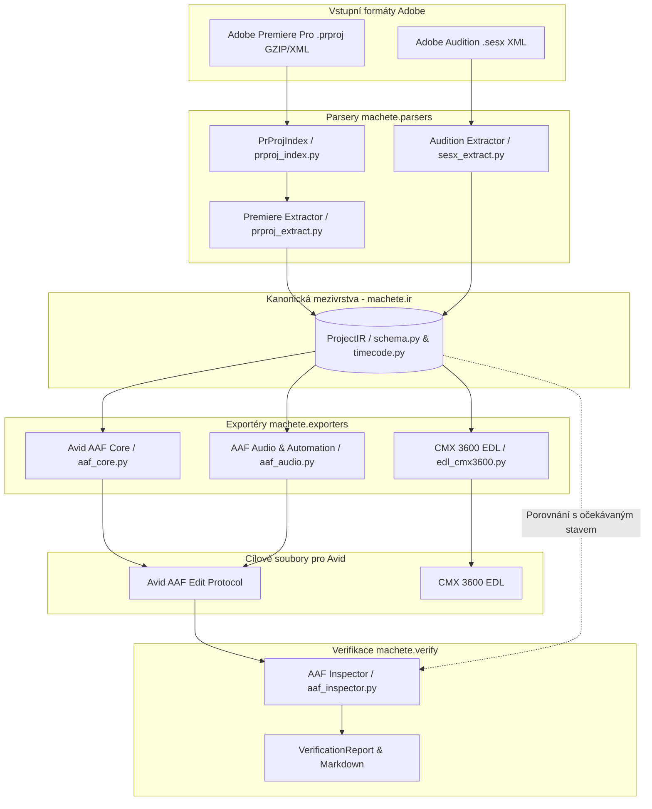
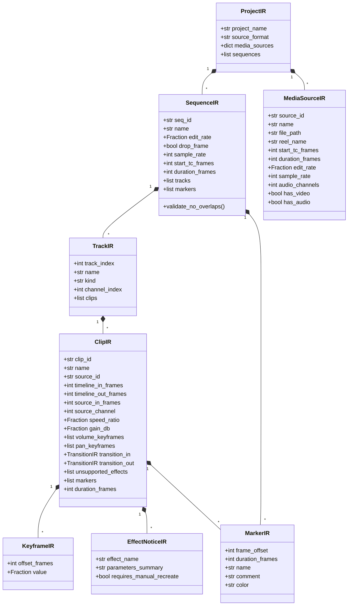
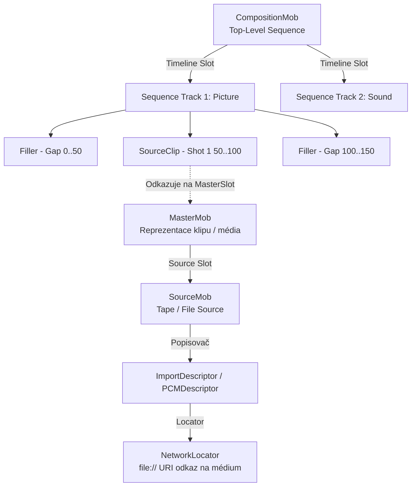

# Projektová dokumentace: Křovákova Sekera (`krovak-machete`)

> **Deterministický překladač filmových projektů Adobe Premiere Pro (`.prproj`) a Adobe Audition (`.sesx`) do nativního formátu Avid AAF (`.aaf` Edit Protocol) a CMX 3600 EDL pro Avid Media Composer a Avid Pro Tools.**

---

## 1. Úvod a vize projektu

### 1.1 Kontext filmové a televizní postprodukce
Ve filmové a televizní praxi probíhá obrazový střih často v aplikaci **Adobe Premiere Pro** a zvuková postprodukce nebo náběry v **Adobe Audition**. Nicméně průmyslovým standardem pro finální online obrazovou střižnu, conform, barevné korekce a především finální zvukový mix v dabingových a zvukových studiích zůstává ekosystém Avid – **Avid Media Composer** a **Avid Pro Tools**.

Standardní exportní cesty z aplikací Adobe (vestavěný AAF export či OMF) dlouhodobě trpí zásadními neduhy:
* **Snímkový a vzorkový drift:** Při převodu časových kódů (zejména u neceločíselných frekvencí jako 23.976 nebo 29.97 fps) dochází na celovečerních stopážích (3+ hodiny) k rozchodu obrazu a zvuku o několik snímků.
* **Ztráta informací o efektech:** Nestandardní efekty Adobe Premiere (Warp Stabilizer, Lumetri Color, remapping rychlosti) jsou obvykle buď tiše zahozeny, nebo zhavarují import v Avidu.
* **Závislost na běžícím Adobe softwaru:** Konverzi nelze snadno automatizovat na renderovacích serverech bez instalovaných a licencovaných Adobe Creative Cloud aplikací.
* **Porušování specifikace Avid Edit Protocol:** Vznik nekonzistentních stop s mezerami (gaps), které Media Composer odmítne načíst nebo vyžadují zdlouhavý manuální conform.

### 1.2 Poslání nástroje „Křovákova Sekera“
**Křovákova Sekera (`krovak-machete`)** je navržena jako nekompromisní, plně deterministický softwarový nástroj, který jako trpasličí kameník oseká chaotickou skálu XML struktur projektů Adobe na přesné kvádry a postaví z nich 100% validní binární zeď **Avid AAF** a textového **CMX 3600 EDL**.

**Klíčové pilíře projektu:**
1. **100% Frame & Sample Accuracy:** Nulová tolerance odchylky na časové ose i při stopážích přesahujících 3 hodiny.
2. **Nezávislost na Adobe aplikacích:** Přímé binární čtení komprimovaných GZIP archivů `.prproj` a XML souborů `.sesx` pomocí standardní knihovny Pythonu.
3. **Striktní dodržování Avid standardů:** Striktní dodržení **Avid Zero-Gap Law**, deterministická generace Mob ID pro stabilní relinkování a správná struktura deskriptorů.
4. **Transformace nepodporovaných efektů na červené markery:** Žádný efekt nezmizí beze stopy. Editor v Avidu přesně vidí, kde v Premiere byl jaký filtr.
5. **Dvojí rozhraní:** Výkonné CLI pro dávkové zpracování v postprodukční pipeline a jednoduché „one-click“ GUI okno pro střihače (Křováka).

---

## 2. Systémová architektura a klíčové invarianty

### 2.1 Třívrstvá architektura a „Kanonická stěna“ (Canonical IR Wall)
Architektura systému je navržena podle principu čisté separace odpovědností (Separation of Concerns). Jádrem systému je striktní rozhraní **Kanonického IR** (`ProjectIR`), které vytváří nepropustnou stěnu mezi vstupními parsery a výstupními exportéry.



### 2.2 Osm nedotknutelných invariantů projektu
Projekt definuje 8 přísných pravidel, která musí dodržet jakýkoliv kód i AI agent:

1. **NO-FLOAT TIME LAW:** Pro reprezentaci času, snímkových frekvencí, Premiere tiků ani vzorků zvuku se **nesmí nikdy použít datový typ `float`**. Veškerá matematika probíhá výhradně v `fractions.Fraction` nebo přesných celých číslech `int`.
2. **PREMIERE TICKS CONSTANT:** Základní časová jednotka Adobe Premiere Pro je definována přesně jako:
   $$\text{PPRO\_TICKS\_PER\_SEC} = 254\,016\,000\,000 \text{ tiků za sekundu}$$
3. **AUDITION SAMPLES:** Čas v Adobe Audition (`.sesx`) je měřen v celočíselných zvukových vzorcích vztažených k vzorkovací frekvenci relace (např. 48 000 Hz).
4. **CANONICAL IR WALL:** Parsery (`src/machete/parsers/`) smí produkovat výhradně instance `ProjectIR`. Exportéry (`src/machete/exporters/`) smí číst výhradně `ProjectIR`. Přímé propojení parseru s AAF exportérem je přísně zakázáno.
5. **SCHEMA LOCK:** Po dokončení základního návrhu schématu je soubor `src/machete/ir/schema.py` uzamčen pro čtení (Read-Only) pro všechny navazující komponenty.
6. **AVID ZERO-GAP LAW:** Každá stopa v Avid AAF sekvenci musí začínat na snímku `0` a musí být spojitá. Veškerá prázdná místa mezi klipy **musí** být vyplněna komponentami `aaf2.components.Filler` přesné celočíselné délky. Součet délek všech komponent stopy se musí přesně rovnat celkové délce sekvence (`duration_frames`).
7. **DETERMINISTIC MOB IDs:** Identifikátory `aaf2.mobid.MobID` musí být generovány deterministicky pomocí:
   $$\text{UUID} = \text{uuid.uuid5}(\text{uuid.NAMESPACE\_DNS}, \text{"krovak.machete:"} + \text{seed\_string})$$
   Tím je garantováno, že opakovaný export stejného projektu vygeneruje shodná MobID pro bezproblémový relink v Media Composeru i Pro Tools.
8. **UNSUPPORTED ADOBE EFFECTS -> RED MARKERS:** Žádný efekt z Premiere (Lumetri, Warp Stabilizer, časový remapping) nesmí být v tichosti zahozen. Všechny tyto efekty se převádějí na červené značky (`MarkerIR` s barvou `red`) na časové ose s detailním popisem parametrů pro střihače.

---

## 3. Matematický aparát a Timecode Engine

### 3.1 Standardní vysílací snímkové frekvence
Všechny standardní střihové frekvence jsou v modulu `src/machete/ir/timecode.py` definovány jako racionální zlomky:

| Název frekvence | `Fraction` vyjádření | Desetinná aproximace | Typické použití |
| :--- | :--- | :--- | :--- |
| `"23.976"` | `Fraction(24000, 1001)` | ~23.97602398 fps | Filmová produkce USA, Netflix, NTSC film |
| `"24"` | `Fraction(24, 1)` | 24.0 fps | Klasický celovečerní kinofilm |
| `"25"` | `Fraction(25, 1)` | 25.0 fps | Evropský televizní a filmový standard (PAL) |
| `"29.97"` | `Fraction(30000, 1001)` | ~29.97002997 fps | Televizní vysílání NTSC (USA / Japonsko) |
| `"30"` | `Fraction(30, 1)` | 30.0 fps | Webové video, standardní záznam |
| `"50"` | `Fraction(50, 1)` | 50.0 fps | Evropské vysílání sportu a HDTV (PAL progressive) |
| `"59.94"` | `Fraction(60000, 1001)` | ~59.94005994 fps | NTSC progressive vysílání |
| `"60"` | `Fraction(60, 1)` | 60.0 fps | Hry, vysokofrekvenční záznam |

### 3.2 Algoritmy pro racionální přepočet

#### Převod Premiere Ticks <-> Snímky
Premiere Ticks jsou převedeny na celočíselný snímek s půl-zaokrouhlením:
$$\text{frames} = \left\lfloor \frac{\text{ticks}}{\text{PPRO\_TICKS\_PER\_SEC}} \cdot \text{edit\_rate} + \frac{1}{2} \right\rfloor$$
Zpětný přepočet:
$$\text{ticks} = \left\lfloor \frac{\text{frames}}{\text{edit\_rate}} \cdot \text{PPRO\_TICKS\_PER\_SEC} + \frac{1}{2} \right\rfloor$$

#### Převod Zvukové vzorky <-> Snímky
$$\text{frames} = \left\lfloor \frac{\text{samples}}{\text{sample\_rate}} \cdot \text{edit\_rate} + \frac{1}{2} \right\rfloor$$
$$\text{samples} = \left\lfloor \frac{\text{frames}}{\text{edit\_rate}} \cdot \text{sample\_rate} + \frac{1}{2} \right\rfloor$$

### 3.3 SMPTE 12M časový kód (Non-Drop Frame a Drop-Frame)
Pro zobrazení časového kódu střihači je implementována funkce `frames_to_smpte_tc(frames, edit_rate, drop_frame)`:
* **Non-Drop Frame (NDF):** Formát `HH:MM:SS:FF`. Přímý celočíselný přepočet bez vynechávání čísel.
* **Drop-Frame (DF):** Formát `HH:MM:SS;FF`. U frekvence 29.97 fps (s 30 fps časovým kódem) reálný čas předbíhá počítadlo o 108 snímků za hodinu. Norma SMPTE vynechává první dvě čísla snímků (FF=00 a FF=01) na začátku každé minuty s výjimkou každé desáté minuty (minuty 00, 10, 20, 30, 40, 50).
  * V 10minutovém bloku je přesně:
    $$D_{10} = 10 \times 60 \times 30 - 9 \times 2 = 18\,000 - 18 = 17\,982 \text{ snímků}$$
  * U frekvence 59.94 fps se analogicky vynechávají 4 snímky (00, 01, 02, 03).

---

## 4. Datový model kanonického IR (`schema.py`)

Kanonický model je definován pomocí Pydantic v2 a zajišťuje typovou bezpečnost celého překladu.



### 4.1 Klíčová validační logika
Metoda `SequenceIR.validate_no_overlaps()` provádí striktní kontrolu integrity:
1. Ověřuje, že pro každý klip platí $\text{timeline\_out\_frames} > \text{timeline\_in\_frames}$.
2. Ověřuje nezápornost všech časových souřadnic.
3. Seřadí klipy na stopě podle `timeline_in_frames` a verifikuje, že pro sousední klipy platí:
   $$\text{clip}_{i}.\text{timeline\_out\_frames} \le \text{clip}_{i+1}.\text{timeline\_in\_frames}$$
   Při zjištění překryvu je okamžitě vyvolána výjimka `ValueError`.

---

## 5. Reverzní inženýrství vstupních formátů

### 5.1 Adobe Premiere Pro (`.prproj`)
Soubor `.prproj` je ve skutečnosti XML dokument komprimovaný algoritmem GZIP (detekovatelný magickými bajty `1f 8b` na začátku souboru).

#### Struktura grafu a dereference pointerů (`prproj_index.py`)
Struktura Premiere neukládá sekvence a klipy lineárně, nýbrž jako relační objektový graf svázaný dvěma typy identifikátorů:
* `ObjectID` (lokální celočíselné ID v rámci souboru)
* `ObjectUID` (globální GUID řetězec)

Odkazy mezi objekty jsou realizovány XML elementy s atributy `ObjectRef="..."` nebo `ObjectURef="..."`. Modul `PrProjIndex` provádí:
1. Jednoprůchodovou indexaci kořene XML do tabulek `by_id` a `by_uid`.
2. Metodu `deref(parent, xpath)` a `deref_all(parent, xpath)`, které prochází řetězec referencí až k cílovému objektu (např. od `TrackItem` přes `SubClip` a `Clip` k `Source` a `Media`).

#### Rekurzivní zplošťování vnořených sekvencí (Nested Sequences)
Pokud střihač v Premiere použije vnořenou sekvenci (Nest), `<Source>` klipu neodkazuje na `<Media>`, nýbrž na jiný `<Sequence>` element. Modul `prproj_extract.py` implementuje rekurzivní flattening:
1. Detekuje odkaz na sekvenci.
2. Načte stopy a klipy podřízené sekvence.
3. Přepočte jejich časové souřadnice vůči začátku vnořeného klipu na hlavní časové ose:
   $$\text{new\_in} = \text{parent\_timeline\_in} + (\text{child\_timeline\_in} - \text{parent\_source\_in})$$
4. Ořízne klipy tak, aby nepřesáhly hranice rodičovského klipu (`parent_timeline_in` až `parent_timeline_out`).

#### Ošetření L-cutů a J-cutů
V Premiere jsou video a audio části téhož záběru často provázány, ale jejich hrany jsou posunuty (zvuk začíná dříve – J-cut, nebo obraz končí dříve – L-cut). Parsery extrahují video stopu (`kind="picture"`) a audio stopu (`kind="sound"`) nezávisle a zachovávají přesné časové offsety.

#### Detekce nepodporovaných efektů
V XML stromu klipu se vyhledávají komponenty `<VideoFilterComponent>` a `<AudioFilterComponent>`. Pokud komponenta představuje efekt nepřenositelný do standardního AAF (např. *Warp Stabilizer*, *Lumetri Color*, *Time Remapping*):
1. Vytvoří se `EffectNoticeIR` s parametry.
2. Na časovou osu se na pozici `timeline_in_frames` vloží červený `MarkerIR` s názvem `ADOBE FX: {název}` a komentářem pro střihače.

### 5.2 Adobe Audition (`.sesx`)
Soubor `.sesx` je standardní nekomprimovaný XML soubor reprezentující multitrackovou zvukovou relaci.
* V hlavičce `<session>` je specifikována vzorkovací frekvence (`sampleRate`, např. 48000 Hz) a celková délka.
* Zvukové soubory jsou mapovány z elementů `<files>/<file>`.
* Zvukové klipy `<audioClip>` obsahují souřadnice `startPoint`, `endPoint` a `sourceInPoint` vyjádřené v celých vzorcích.
* Modul `sesx_extract.py` převádí tyto hodnoty na snímky cílové sekvence pomocí `samples_to_frames` a extrahuje obálky hlasitosti (fade-in, fade-out a volume keyframes).

---

## 6. Výstupní formáty a Avid standardy

### 6.1 Avid AAF Core (`aaf_core.py`)
Avid AAF (Advanced Authoring Format dle specifikace Edit Protocol) vyžaduje striktní hierarchii objektů zvaných **Mobs** (Metadata Objects):



#### Implementace Avid Zero-Gap Law
Pro každou stopu kompozice je udržován kurzor `cursor_frame = 0`:
1. Klipy na stopě jsou seřazeny podle `timeline_in_frames`.
2. Pokud `clip.timeline_in_frames > cursor_frame`, je před klip vložen `f.create.Filler(kind, clip.timeline_in_frames - cursor_frame)`.
3. Vloží se `SourceClip` odkazující na příslušný `MasterMob`.
4. Kurzor se posune na `clip.timeline_out_frames`.
5. Pokud po posledním klipu platí `cursor_frame < seq.duration_frames`, stopa je doplněna koncovým `Fillerem`, aby všechny stopy měly identickou celkovou délku.

### 6.2 Zvuk a automatizace (`aaf_audio.py`)
Pro zvukové stopy nabízí nástroj dva režimy:

1. **Embedded Audio Essence (`embed_audio=True`):**
   * Vhodné pro předávání kompletního projektu zvukařům do **Pro Tools**.
   * Reálný WAV soubor je otevřen a jeho surová PCM data jsou zapsána přímo do vnitřního úložiště AAF (`EssenceData`) spojeného s `SourceMob`.
   * Vytvoří se `PCMDescriptor` s přesně vyplněnými atributy (`SampleRate=48000`, `QuantizationBits=16`, `Channels`, `BlockAlign`).
2. **Linked Audio (`embed_audio=False`):**
   * Vhodné pro Media Composer sdílející společné diskové pole (SAN/NAS).
   * Do AAF se zapíše `NetworkLocator` s absolutním URI odkazem na externí soubor na disku.

#### Stereo-to-Mono Splitter
Pro Tools a řada starších Avid pipeline vyžaduje striktně monofonní stopy. Pomocná funkce `split_stereo_tracks_to_mono(seq_ir)` automaticky rozdělí jakoukoliv stereo stopu na dvě mono stopy (`A1.L` s `channel_index=1` a `A1.R` s `channel_index=2`) se zachováním shodných časových kódů.

#### Automatizace hlasitosti
Zesílení klipu (`gain_db`) a jednotlivé body křivky hlasitosti (`volume_keyframes`) jsou zapisovány do parametrů operace a současně do strukturovaných metadat klipu, což zajišťuje bezeztrátovou interpretaci jak v Media Composeru, tak v našem verifikátoru.

### 6.3 CMX 3600 EDL Fallback (`edl_cmx3600.py`)
Pro případy extrémně starých střižen nebo nouzového conformu generuje systém standardní textový soubor CMX 3600:
* Hlavička s názvem sekvence a typem časového kódu (`FCM: NON-DROP FRAME` / `DROP FRAME`).
* Standardní číslování událostí (např. `001 AX V C 01:00:00:00 01:00:05:00 01:00:00:00 01:00:05:00`).
* Komentáře klipů `* FROM CLIP NAME: ...`.
* Převod nepodporovaných efektů a značek do řádků lokátorů:
  `* LOC: 01:00:02:15 RED ADOBE FX: Warp Stabilizer`.

---

## 7. Verifikace a kontrola kvality

### 7.1 Kruhový inspektor (`aaf_inspector.py`)
Systém obsahuje nezávislý verifikační engine, který po vygenerování souboru `.aaf` tento soubor znovu binárně otevře v režimu pro čtení a porovná jej s původním `ProjectIR`.

Inspektor kontroluje:
1. **Existenci všech sekvencí a deterministických MobID.**
2. **Dodržení Zero-Gap pravidla:** Žádná komponenta nemá délku $\le 0$ a součet délek přesně odpovídá délce sekvence.
3. **Snímkovou přesnost klipů:** Každý `SourceClip` musí mít na časové ose nulovou odchylku ($\Delta = 0$ snímků) vůči původnímu `ClipIR`.
4. **Přítomnost a formát značek a varování na efekty.**

### 7.2 Diagnostický protokol (`VerificationReport`)
Výstupem verifikace je strukturovaná zpráva, která se střihači zobrazí buď v terminálu, v okně GUI, nebo se uloží do souboru Markdown:

```markdown
# Protokol verifikace Křovákova Sekera
- **Sekvence:** Hlavni_Strih_25fps
- **Stav:** VALIDNÍ (100% shoda časové osy)
- **Celkem stop:** 3 (V1, A1, A2) | **Klipů:** 42 | **Výplní (Fillers):** 18
- **Detekované chyby:** 0

### Seznam upozornění na nepodporované efekty (Červené značky v Avidu):
| Časový kód (SMPTE) | Stopa | Klip | Zjištěný Adobe efekt |
| :--- | :--- | :--- | :--- |
| `01:02:14:10` | V1 | `Rozhovor_KameraA` | `ADOBE FX: Warp Stabilizer` |
| `01:15:30:00` | V1 | `Dron_Zaber_04` | `ADOBE FX: Lumetri Color (LUT applied)` |
```

---

## 8. Uživatelská rozhraní

### 8.1 Rozhraní příkazového řádku (CLI)
Příkaz `machete` nabízí intuitivní rozhraní:

```bash
# Základní převod Premiere projektu do AAF s kontrolním reportem
machete convert film_final.prproj -o film_final.aaf --report report.md

# Kompletní převod pro zvukové studio Pro Tools (vložené audio + mono stopy)
machete convert session.sesx -o mix_protools.aaf --embed-audio --split-mono

# Převod s vytvořením záložního CMX 3600 EDL
machete convert projekt.prproj -o projekt.aaf --also-edl

# Spuštění grafického okna
machete gui
```

**Návratové kódy:**
* `0`: Úspěšná konverze a 100% validní výstup.
* `1`: Chyba při parsování, exportu nebo selhání verifikace.

### 8.2 Grafické rozhraní „Křovákova Sekera“ (`gui.py`)
Stylové desktopové okno postavené na vestavěné knihovně `tkinter` (nevyžaduje instalaci žádných externích GUI knihoven), laděné do estetiky starého pergamenu (`#F3EBD8`) a černé tolkienovské dřevorytové kresby (`#1E1E1E`):
* **Pečeť trpaslíka** (`src/machete/assets/dwarf_seal.png` / `.icns`) jako ikona okna a spouštěče.
* Výběr vstupního souboru (`.prproj` / `.sesx`) a cílového `.aaf`.
* Přepínače pro:
  - `[x] Zploštit vnořené sekvence (Flatten Nested Sequences)`
  - `[x] Vložit WAV zvuk přímo do AAF (Embedded Audio pro Pro Tools)`
  - `[x] Rozdělit stereo stopy na mono (A1.L / A2.R)`
  - `[x] Vygenerovat záložní CMX 3600 EDL a kontrolní report`
* Výrazné akční tlačítko **„ZATNOUT SEKERU DO ADOBE“**.
* **Asynchronní Trpasličí Progress Monitor (`DwarfProgressMonitor`):**
  - Běží na pozadí ve vlastním vlákně (`threading.Thread` + `queue.Queue`), takže okno během konverze celovečerních projektů nikdy nezamrzá.
  - Na pergamenovém plátně (`tk.Canvas`) zobrazuje rytinu trpaslíka (`src/machete/assets/dwarf_scene.png`), který seká hrubou Adobe skálu a z otesaných kvádrů staví pevnou zeď Avid AAF (`0–100 %`), doplněnou o animované odletující úlomky a kamenické stavové hlášky.
* Textový panel se zobrazením kontrolního protokolu ihned po dokončení.

---

## 9. Příručka pro instalaci a spuštění

### 10.1 Systémové požadavky
* **Python:** 3.11 nebo novější
* **Operační systém:** macOS, Linux, Windows
* **Klíčové závislosti:**
  - `pyaaf2 >= 1.7.0` (binární manipulace s AAF)
  - `pydantic >= 2.6.0` (datová validace a schéma)
  - `pytest >= 8.0.0` (automatizované testování)

### 10.2 Instalace pro vývoj
```bash
# Klonování / přechod do repozitáře
cd /Users/petrnovak/Documents/Machete

# Vytvoření virtuálního prostředí
python3 -m venv .venv
source .venv/bin/activate

# Instalace projektu v editovatelném režimu včetně testovacích nástrojů
pip install -e ".[dev]"
```

### 10.3 Spuštění testovací sady
```bash
# Spuštění všech testů
pytest

# Spuštění testů konkrétního modulu (např. timecode)
pytest tests/test_timecode.py
```
